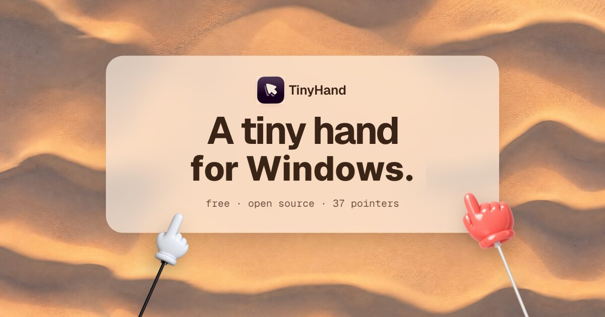

> [!WARNING]
> This is a Windows rewrite of the original [TinyHand](https://github.com/nilbuild/tinyhand).
> All rights belong to [github.com/nilbuild](https://github.com/nilbuild).


# TinyHand

[](https://github.com/OmiChrome/tinyhand-win/releases/latest)
[](https://github.com/OmiChrome/tinyhand-win/releases/latest)
[](./LICENSE)

A tiny hand on a stick that points at things on your Windows screen.



[](https://github.com/OmiChrome/tinyhand-win/releases/latest/download/TinyHand-win-Setup.exe)

Windows 10 or later, x64.

## Use

| | |
|---|---|
| Click the tray icon, or **Ctrl+Alt+H** | Turn the pointer on or off |
| Right-click the tray icon | Menu and Settings |
| Click | Tap (nothing underneath gets clicked) |
| Hold and drag | Draw on the screen |
| Hold **Alt** and click | Click for real |
| **Ctrl+Alt+X** | Clear the drawing |
| **Esc** | Clear everything and turn the pointer off |

While the pointer is on, a small toolbar at the bottom of the screen lets you pick one of
36 hands or a laser dot, change the ink colour, mute the tap sound, or exit.

## Build

```powershell
git clone --recurse-submodules https://github.com/OmiChrome/tinyhand-win
dotnet run --project tinyhand-win/src/TinyHand
```

Needs the [.NET 10 SDK](https://dotnet.microsoft.com/download). The original app is in the
`tinyhand` submodule; `scripts/sync-upstream.ps1` updates it and lists what changed.
Bump `VERSION` on `main` to publish a release.

## License

MIT. See [LICENSE](LICENSE).
